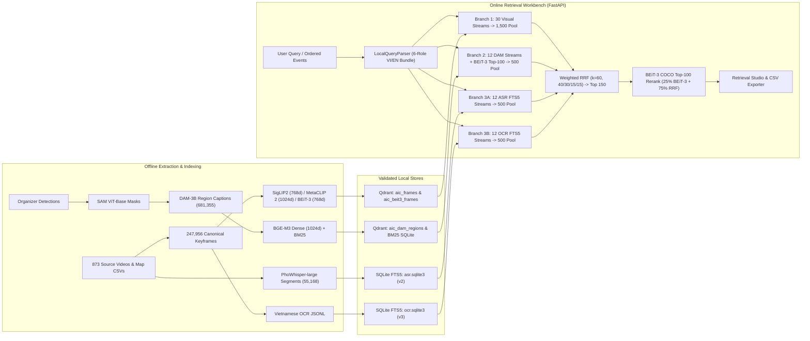

# AIC 2026 — Multimodal Video Retrieval System

[](pyproject.toml)
[](online/cpu_server.py)
[](docker-compose.qdrant.yml)
[](package.json)
[](scripts/native_macos/aic_local.sh)

A production-grade multimodal video search engine and interactive retrieval workbench built for the **Ho Chi Minh City AI Challenge (AIC) 2026**. The system indexes **873 videos**, **247,956 canonical keyframes**, **681,355 localized object descriptions**, and **55,168 timestamped speech segments** to solve **Known-Item Search (KIS)**, **Video Q&A**, and **Temporal Action / Event Retrieval (TRAKE)** under strict `R@1 / R@5 / R@20 / R@50 / R@100` evaluation gates.

---

## Key Highlights

- **4-Branch Multimodal Retrieval + Weighted RRF + BEiT-3 Reranking**: Combines tri-model visual search (`SigLIP2`, `MetaCLIP 2`, `BEiT-3`), localized object region search (`SAM` + `DAM-3B` indexed via `BGE-M3` + `BM25`), Vietnamese speech transcripts (`PhoWhisper` FTS5), and Vietnamese on-screen OCR (FTS5) into one unified **KIS Fusion** pipeline.
- **Deterministic 6-Role Bilingual Query Planning**: Parses queries into six structured roles (`original`, `entity`, `action`, `context`, `synonym`, `keyword`) in Vietnamese and English (`branch1.query.v1`) locally with zero external LLM API calls or keys required at runtime.
- **Ordered KIS Events (TRAKE)**: Decomposes 2–6 sequential events (inheriting only the shared `context` role to prevent cross-event leakage), executes the full KIS pipeline per event, and enforces strictly increasing source-frame indexes and timestamps within each candidate video.
- **Memory-Safe Isolated Encoder Workers**: Runs each heavy neural encoder (`SigLIP2`, `MetaCLIP 2`, `BGE-M3`, `BEiT-3`) in an isolated subprocess that auto-exits after 30 seconds of idle time to reclaim RAM, backed by a persistent SQLite query-embedding cache (`query_embeddings.sqlite3`).
- **Fail-Closed Data & Index Integrity**: Validates matrix shapes, finiteness, L2 normalization, SHA-256 model manifests, and canonical frame-ID parity before startup; publishes SQLite FTS5 indexes atomically (`ocr.sqlite3` v3, `asr.sqlite3` v2).
- **Dual Deployment Targets**: Ships both a cross-platform **Docker Compose CPU stack** and a **Native Apple Silicon MPS launcher** (`scripts/native_macos/aic_local.sh`) with per-worker CPU fallback.
- **Interactive Retrieval Studio**: Web UI featuring independent branch diagnostics, inspector bounding-box and OCR polygon overlays, YouTube/video timestamp mapping, video-scoped visual search, and a 100-row competition CSV submission builder keyed to exact zero-based canonical `frame_idx`.

---

## System Architecture



---

## 4-Branch Retrieval Engine

| Stage | Models / Engine | Query Streams & Pool Caps | Scoring & Reranking |
|---|---|---|---|
| **Branch 1 — Visual Fusion** | `SigLIP2` (768d), `MetaCLIP 2` (1024d), `BEiT-3` (768d) | **30 streams**: 12 VI/EN SigLIP2 + 12 VI/EN MetaCLIP 2 + 6 EN BEiT-3 → **1,500** pool | Model-weighted cosine fusion (`45 / 30 / 25` default) |
| **Branch 2 — Localized Objects** | `BGE-M3` (1024d) + SQLite `BM25` over `SAM` + `DAM-3B` regions | **12 streams**: 6 EN dense + 6 EN BM25 → **500** hybrid pool | Top **100** validated by `BEiT-3` COCO dual-encoder cosine (`40% BEiT-3 + 60% hybrid`) |
| **Branch 3A — Speech (ASR)** | `PhoWhisper-large` segments mapped to nearest keyframes | **12 streams**: 6 VI + 6 EN SQLite FTS5 → **500** pool | Okapi BM25 + n-gram coverage across 55,168 segments (872 speech videos, 1 valid empty video `L30_V029`) |
| **Branch 3B — Screen Text (OCR)** | Vietnamese OCR with diacritic folding & mojibake repair | **12 streams**: 6 VI + 6 EN SQLite FTS5 → **500** pool | Exact + folded Vietnamese token matching verified across all 247,956 frames |
| **KIS Fusion** | Cross-branch rank fusion + `BEiT-3` validation | Combines fixed **1,500 / 500 / 500 / 500** pools → **150** frames | Weighted rank-only RRF (`k=60`, default `40/30/15/15`); ranks 1–100 blended (`25% BEiT-3 + 75% RRF`), ranks 101–150 retain RRF order |
| **Ordered KIS Events (TRAKE)** | Temporal multi-event alignment | Runs full KIS per event (2–6 events) with shared `context` role | Keeps same-video monotonic paths (`frame_idx` and `pts_time_s` strictly increasing) |

In addition to cross-branch KIS, the inspector supports **Video-Scoped Visual Fusion** (`POST /api/video/{video_id}/search/visual-fusion`), filtering Qdrant directly to the selected video and fusing only `SigLIP2`, `MetaCLIP 2`, and `BEiT-3`.

---

## Model & Index Registry

Machine-readable pins live in [`configs/models.yaml`](configs/models.yaml) and [`docs/model-registry.md`](docs/model-registry.md):

| Role | Model / Artifact | Dimensions / Format | Revision / Verification |
|---|---|---|---|
| **Mask Refinement** | `facebook/sam-vit-base` | COCO RLE masks | `70c1a07f894ebb5b307fd9eaaee97b9dfc16068f` |
| **Region Captioning** | `nvidia/DAM-3B` (`NVlabs/describe-anything`) | ≤20-word EN descriptions | `0797bedd98d645cd021379a4661ee233da279bba` (code `153ad3d33c29324e9197f565547c6bc8500da02d`) |
| **Visual Scene (VI/EN)** | `google/siglip2-base-patch16-224` | 768d, L2, max 64 tokens | `75de2d55ec2d0b4efc50b3e9ad70dba96a7b2fa2` |
| **Visual-Text (VI/EN)** | `facebook/metaclip-2-worldwide-huge-quickgelu` | 1024d, L2, max 77 tokens | `2431b607fc8e05dd43b73797ba1a7a042514bcf4` |
| **Visual & Reranker (EN)** | `beit3_base_patch16_384_coco_retrieval.pth` | 768d `language_head`, max 64 tokens | UniLM `ca43e4cd19445a536f133bf2bc25b573b2f0c7c5`, SHA-256 verified |
| **DAM Dense Text (EN)** | `BAAI/bge-m3` | 1024d CLS, L2, max 512 tokens | Snapshot SHA-256 inventory in `query_models.json` |
| **Vietnamese ASR** | `vinai/PhoWhisper-large` (`kiendt/PhoWhisper-large-ct2`) | 30s window / 15s stride | `branch3.asr-index.v2` (55,168 segments) |
| **Vietnamese OCR** | Frame-level OCR JSONL | SQLite FTS5 (`ocr.sqlite3`) | `branch3.ocr-index.v3` (247,956 frames) |

---

## Quick Start

### Option A — Preview the Retrieval Studio UI (Mock Mode, No Dataset Required)

Explore the full search workbench, query planner, inspector overlays, and CSV submission exporter using deterministic mock data:

```bash
npm ci
npm run dev:mock
```

Open **<http://127.0.0.1:5173>**.

---

### Option B — Full Docker Stack (Qdrant + CPU Search API + Compiled UI)

1. Place your extracted competition artifacts under `./data` following [`online/DATA_STRUCTURE.md`](online/DATA_STRUCTURE.md).
2. Start Qdrant, download pinned query/Branch-1 models, prepare branch gates and FTS5 indexes, and verify vector ingestion:

```bash
docker compose -f docker-compose.qdrant.yml up -d qdrant
docker compose -f docker-compose.qdrant.yml --profile tools run --rm query-model-setup
docker compose -f docker-compose.qdrant.yml --profile tools run --rm branch1-model-setup
docker compose -f docker-compose.qdrant.yml --profile tools run --rm branch1-prepare
docker compose -f docker-compose.qdrant.yml --profile tools run --rm branch2-prepare
docker compose -f docker-compose.qdrant.yml --profile tools run --rm text-index-prepare
docker compose -f docker-compose.qdrant.yml --profile tools run --rm asr-index-prepare
docker compose -f docker-compose.qdrant.yml --profile tools run --rm qdrant-ingest --verify-only
```

3. Start the retrieval API and compiled frontend:

```bash
docker compose -f docker-compose.qdrant.yml up -d qdrant search-api
```

Open **<http://127.0.0.1:8890>** (Qdrant dashboard at <http://127.0.0.1:6333/dashboard>). See [`online/README.md`](online/README.md) and [`scripts/qdrant/README.md`](scripts/qdrant/README.md) for in-place Qdrant repair, index rebuilds, and RAM qualification.

---

### Option C — Native Apple Silicon MPS Launcher (macOS, No Docker)

Runs PyTorch MPS (`SigLIP2`, `MetaCLIP 2`, `BGE-M3`, `BEiT-3`, and DAM exact tensor scoring) alongside native ARM64 Qdrant and SQLite FTS5:

```bash
AIC_DATA_ROOT=/path/to/data ./scripts/native_macos/aic_local.sh setup
./scripts/native_macos/aic_local.sh start
./scripts/native_macos/aic_local.sh status
./scripts/native_macos/aic_local.sh stop
```

By default `AIC_DATA_ROOT` resolves to `./data`. Override `AIC_METACLIP2_SOURCE`, `AIC_BEIT3_SOURCE`, `AIC_LOCAL_RUNTIME_ROOT`, `AIC_LOCAL_VENV_ROOT`, or `AIC_PYTHON312_BIN` as needed.

---

### Option D — Offline Cloud Feature Extraction (Colab / Kaggle)

Reproducible CLI runners and thin cloud notebook launchers are provided for GPU extraction:

- **Colab single-video SAM + DAM**: [`notebooks/colab_object_description.ipynb`](notebooks/colab_object_description.ipynb)
- **Kaggle single-video smoke / offline mirror**: [`notebooks/kaggle_object_description.ipynb`](notebooks/kaggle_object_description.ipynb)
- **Kaggle parameterized distributed DAM worker (`WORKER_ID` of `NUM_WORKERS`)**: [`notebooks/kaggle_dam_worker.ipynb`](notebooks/kaggle_dam_worker.ipynb)
- **CLI runners**: `scripts/build_frame_manifest.py`, `scripts/prepare_object_masks.py`, `scripts/run_dam_descriptions.py`, `scripts/run_dam_batch.py`, `scripts/run_phowhisper_asr.py`

See [`docs/cloud-runbook.md`](docs/cloud-runbook.md) for environment setup and Kaggle Internet-off instructions.

---

## Repository Structure

```text
AIC-2026/
├── .github/workflows/ci.yml        # Python, Online Retrieval, and Frontend CI pipelines
├── configs/                        # Model registry (models.yaml), stage YAML configs, video lists
├── docs/                           # Architecture, data contracts, model registry, runbooks
├── notebooks/                      # Thin Colab/Kaggle extraction & distributed DAM worker notebooks
├── online/
│   ├── cpu_server.py               # FastAPI entry point (online.cpu_server:app) & health gates
│   ├── frontend/                   # Retrieval Studio UI (Vite, TypeScript, JS, mock plugin, tests)
│   ├── src/
│   │   ├── contracts/              # Query & HTTP request Pydantic schemas (api.py, query.py)
│   │   ├── retrieval/
│   │   │   ├── branches/           # branch1, branch2, branch3 (ASR/OCR), final_fusion, rerankers
│   │   │   ├── encoders/           # Isolated per-model worker manager & CPU/MPS routing
│   │   │   ├── infrastructure/     # Qdrant client, SQLite cache, metadata, query parser, resources
│   │   │   └── modalities/         # FTS5 OCR/ASR indexes, lexical folding, temporal workbench
│   │   └── submission/             # Task-aware 100-row CSV builder, source-frame & related-frame index
│   └── tests/                      # 19 unit & contract test suites for online retrieval & API
├── requirements/                   # Cloud/offline dependency profiles (Colab, Kaggle, dev)
├── scripts/
│   ├── native_macos/               # Apple Silicon MPS setup/start/stop launcher
│   ├── qdrant/                     # Dockerfiles, collection ingestion, branch & FTS5 prep scripts
│   └── ...                         # Offline extraction, validation & frontend build check scripts
├── src/aic2026/                    # Offline pipeline library (ASR, object description, contracts, I/O)
├── tests/                          # Offline unit/integration tests & repository policy checks
├── docker-compose.qdrant.yml       # Local Qdrant + CPU Search API + tool profiles
├── package.json                    # Frontend dependencies & quality/build scripts
└── pyproject.toml                  # Python package definition, Ruff & pytest configuration
```

---

## Testing & Verification

```bash
# 1. Offline package, contract & repository policy checks
ruff check . && ruff format --check .
pytest -m "not gpu and not slow"

# 2. Online retrieval, fusion, temporal, and submission tests
PYTHONPATH=. python -m unittest discover -s online/tests -p 'test_*.py' -v

# 3. Frontend syntax, DOM contract, typecheck, unit tests & production build
npm run check
```

---

## Documentation Index

- **System & Retrieval Design**: [`docs/architecture.md`](docs/architecture.md) · [`online/src/retrieval/README.md`](online/src/retrieval/README.md)
- **Data & Frame Identity Contracts**: [`online/DATA_STRUCTURE.md`](online/DATA_STRUCTURE.md) · [`docs/data-contracts.md`](docs/data-contracts.md)
- **Deployment & Operations**: [`online/README.md`](online/README.md) · [`scripts/qdrant/README.md`](scripts/qdrant/README.md) · [`docs/cloud-runbook.md`](docs/cloud-runbook.md)
- **Models & Query Contracts**: [`docs/model-registry.md`](docs/model-registry.md) · [`docs/query-decomposition.md`](docs/query-decomposition.md)
- **Governance**: [`CONTRIBUTING.md`](CONTRIBUTING.md) · [`SECURITY.md`](SECURITY.md)
